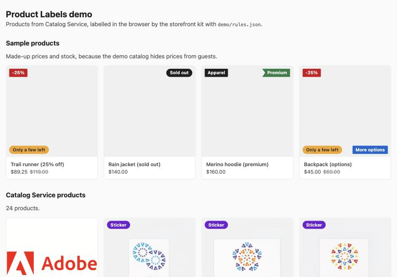
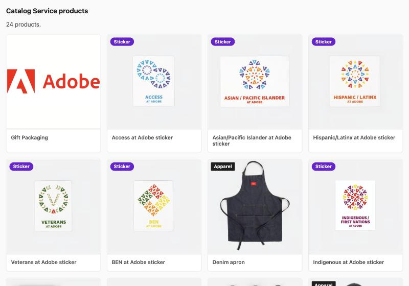

# Product Labels for Adobe Commerce

[](https://github.com/sohelrana09/commerce-product-labels/actions/workflows/ci.yml)
[](https://developer.adobe.com/app-builder/)
[](https://business.adobe.com/products/commerce.html)
[](https://nodejs.org/)
[](storefront/README.md)
[](https://react-spectrum.adobe.com/)
[](https://github.com/sohelrana09/commerce-product-labels)
[](LICENSE)

**Rule-based labels and badges on product images for Adobe Commerce, built as an App Builder app.**

Built by [Sohel Rana](https://sohelrana.io), Adobe Certified Master Architect and Claude Certified Architect – Foundations (CCAR-F).

[Quick start](#quick-start) · [Screenshots](#screenshots) · [Rule format](docs/rules.md) · [Storefront kit](storefront/README.md) · [Contributing](CONTRIBUTING.md)

Product Labels puts merchandising badges on product images: **"-25%"**, **"Sold out"**, **"Only a few left"**, **"New"**, **"Free shipping"**, seasonal campaigns and any custom text. They show on product lists, search results and the product page.
Merchants manage them in the Commerce Admin, with no code and no deployment.

It replaces the label modules merchants used to buy for Magento, and it runs **out of process**. So it works on **Adobe Commerce as a Cloud Service (SaaS)**, where PHP modules can't be installed, as well as on Adobe Commerce on cloud infrastructure and on-premises (PaaS).

**Key features**

- **Labels that write themselves:** text with tokens such as `-{discount_percent}%` or `Save {discount_amount}`, in four corners and four shapes (rectangle, pill, circle, ribbon), in your colors.
- **Precise targeting:** discount percent or amount, final and regular price, stock, low stock, SKU, name, product type and any product attribute, combined with "all" or "any".
- **Campaigns on a schedule:** start and end dates, store views, and product lists or the product page.
- **Priorities:** order labels, cap them per corner, and let "Sold out" hide the rest.
- **No Commerce changes:** no webhooks, events, product attributes or reindexing. The storefront applies the rules to the product data the drop-ins already load.
- **Fast and safe:** one small, cacheable request per browser tab, no layout shift, and label text that can't inject markup.



---

## Contents

- [Who it is for](#who-it-is-for)
- [What shoppers see](#what-shoppers-see)
- [What you manage as a merchant](#what-you-manage-as-a-merchant)
- [Screenshots](#screenshots)
- [How it works](#how-it-works)
- [Quick start](#quick-start)
- [Configuration](#configuration)
- [Commands](#commands)
- [Project structure](#project-structure)
- [Roadmap](#roadmap)
- [FAQ](#faq)
- [Contributing](#contributing)

## Who it is for

- **Merchants** moving to Adobe Commerce as a Cloud Service who relied on a Magento product label module, and need the same badges on SaaS.
- **Agencies and developers** who need a reference build: an Admin UI SDK page, App Management settings, App Builder Database Storage and a public, cacheable storefront action in one small, tested app.
- **Storefront teams** on Edge Delivery Services who want merchandising badges in the Product Discovery and Product Details drop-ins, without code changes for every campaign.

## What shoppers see

| Feature | What it means in practice |
|---|---|
| **Sale badges** | "-25%" or "Save $30", worked out from the price the shopper actually pays, for their customer group and store view. Rounded down, so a badge never overstates a discount. |
| **Stock badges** | "Sold out" and "Only a few left" from Catalog Service stock, the same data as the add-to-cart button. |
| **Campaign badges** | "Black Friday", "New", "Bestseller" or any text, on the products the rule picks by SKU, name, type or attribute. |
| **Everywhere products show** | Product lists, search results, carousels and recommendations, and the product page, including when the shopper picks another variant. |
| **Tidy corners** | Labels stack in four corners, with a cap per corner, so a busy product never gets buried in badges. |
| **No flicker** | Labels sit over the image, so the page never jumps when they appear. If the rules can't load, the page simply shows no labels. |

## What you manage as a merchant

Everything is in the Commerce Admin. There is nothing to deploy for a new campaign.

| You want to... | Where |
|---|---|
| Add, change or remove a label | **Product Labels** in the Admin menu. Start from an example (sale percent, sold out, low stock, new, free shipping) or from scratch. |
| See a label before shoppers do | The editor's **Preview**: a product tile drawn with the storefront's own CSS, for a sample product you describe. **Test a product** shows which saved labels a product gets today. |
| Run a campaign for a week | The label's **Show from** and **Show until** dates. It switches on and off by itself. |
| Show a label in one store view only | The label's **Store views**. |
| Switch every label off, or change the cache time | **Apps → App Management → Product Labels → Configure**. |
| Keep rules in version control | `LABEL_RULES` in `.env` (see [Configuration](#configuration)). |

## Screenshots

| Sample products: sale, stock and campaign labels | Real Catalog Service products |
|---|---|
|  |  |

Both come from the local demo (`npm run demo`). The real products are from Adobe's ACCS demo catalog, which hides prices from guests, so the sample row shows the price and stock labels.

## How it works

```
Commerce Admin ──> Product Labels page (Admin UI SDK, React Spectrum 2)
                     │  IMS sign-in
                     v
               App Builder (I/O Runtime) ──> App Builder Database Storage (label_rules)
                     │
                     │  product-labels/rules: public, cacheable, per store view
                     v
Browser ──> Edge Delivery Services storefront + Commerce drop-ins
              └─ storefront kit: product data from Catalog Service + rules ──> labels over the image
```

Key design choices:

- **Worked out in the browser.** The drop-ins already load each product's prices, stock and attributes. Applying the rules there needs no per-product server calls, no Commerce writes and no reindexing, and discounts follow the shopper's own prices.
- **One engine.** [`product-labels-engine.js`](storefront/scripts/product-labels-engine.js) has no dependencies and is shared by the storefront, the Admin preview and the actions, so what a merchant previews is what shoppers see.
- **Cached, then fresh.** The rules feed is the same for every shopper, so browsers and the CDN cache it (5 minutes by default) and each tab fetches it once. Scheduled labels are sent ahead of time and switch on in the browser at the right moment.
- **Safe by default.** Label text is rendered as text and rejected if it contains markup; colors must be hex. The feed sends only what shoppers see, never Admin names or timestamps.
- **No lock-in.** Plain App Builder, the Admin UI SDK and an ES module for the storefront. Any storefront can call `labelsFor(product, rules)` and draw the labels its own way.

More in [docs/architecture.md](docs/architecture.md).

## Quick start

**You need:** Node.js 24 (`.nvmrc` pins it), the Adobe I/O CLI (`npm install -g @adobe/aio-cli`), an App Builder project in the same Adobe organization as your Commerce instance, and an Edge Delivery Services storefront with the Commerce drop-ins.

1. **Clone and install**

   ```bash
   git clone https://github.com/sohelrana09/commerce-product-labels.git
   cd commerce-product-labels
   npm install
   npm test
   ```

2. **Try it locally (optional)**

   ```bash
   cp demo/config.example.json demo/config.json
   npm run demo
   ```

   Fill in your Catalog Service endpoint and headers in `demo/config.json` (the same values as your storefront's `config.json`), then open http://localhost:4310. The demo labels your products with `demo/rules.json`.

3. **Deploy**

   In the [Adobe Developer Console](https://developer.adobe.com/console), add **I/O Management API**, **App Builder Data Services** and an **OAuth Server-to-Server** credential to the workspace. Then:

   ```bash
   aio login
   aio app use --merge
   cp env.dist .env
   aio app deploy
   ```

   Note the URL it prints for `product-labels/rules`: it is the storefront's rules feed.

4. **Install in Commerce**

   In the Commerce Admin, open **Apps → App Management**, install **Product Labels**, and give the Product Labels ACL resource to the admin roles that manage labels. Open **Product Labels**, start from an example and switch it on.

5. **Add the storefront kit**

   Copy the three files in [`storefront/`](storefront/README.md) into your storefront, set `product-labels-endpoint` in its `config.json`, and add one `appendLabels(...)` call to the product list's image slot and one to the product page. The [storefront guide](storefront/README.md) has the code.

   <details>
   <summary>Keeping rules in code instead</summary>

   Put the rules as a JSON array in `LABEL_RULES` in `.env` (format: [docs/rules.md](docs/rules.md)) and run `aio app deploy`. While it is set, the feed serves those rules and ignores the Admin page.

   </details>

The full guide, with settings, data and troubleshooting, is [docs/installation.md](docs/installation.md).

## Configuration

**App Management** (Apps → App Management → Product Labels → Configure):

| Setting | Purpose |
|---|---|
| Show product labels on the storefront | The master switch (on by default). Off: the feed returns no rules and shoppers see no labels. |
| Most labels in one corner | How many labels stack in one corner of an image, 1 to 10 (default 2). |
| Cache seconds | How long browsers and the CDN may keep the rules feed, 0 to 86400 (default 300). A saved change reaches shoppers within this time. |

**Environment** (`.env`, never commit it; `env.dist` lists every variable):

| Variable | Purpose |
|---|---|
| `LOG_LEVEL` | `debug`, `info` (default), `warn` or `error`. |
| `LABEL_RULES` | Optional. A JSON array of rules; when set, the feed serves these instead of the Admin page's rules. |

**Storefront kit** (`initProductLabels({...})`):

| Option | Purpose |
|---|---|
| `endpoint` | The `product-labels/rules` URL. Without it the kit shows no labels. |
| `storeView` | The store view code, so the feed sends only that view's rules. |
| `locale` | Locale for money tokens (default: the page's `lang`). |
| `cacheSeconds` | How long a browser tab keeps the rules (default 300). |

## Commands

| Command | What it does |
|---|---|
| `npm test` | Unit tests with coverage (Vitest). No Adobe account needed: the database, Commerce and I/O Runtime are faked. |
| `npm run code:check` / `npm run code:fix` | Biome lint and format. |
| `npm run typecheck` | TypeScript check of the Admin page. |
| `npm run demo` | The storefront kit against your Catalog Service, at http://localhost:4310. |
| `aio app dev` | The Admin page locally, against the workspace's actions. |
| `aio app build` / `aio app deploy` | Build, or build and deploy to the selected workspace. |

## Project structure

```
app.commerce.config.ts       App Management: Admin menu, settings, install step
storefront/                  the storefront kit (copied into an EDS storefront)
    scripts/product-labels-engine.js   the rules engine, shared by everything (imported as #engine)
    scripts/product-labels.js          loads the rules feed and draws labels
    styles/product-labels.css          label layout and shapes
src/common/labels/           database, rules repository, settings, rule sources, examples
src/commerce-extensibility-1/
    actions/rules/           the public storefront rules feed
src/commerce-backend-ui-2/
    actions/                 Admin actions: rules-list, rule-save, rule-delete, lookups
    web-src/                 the Admin page (React Spectrum 2)
scripts/setup-database.js    the App Management install step
demo/                        local demo against a Catalog Service endpoint
docs/                        guides and screenshots
test/                        unit tests
```

## Roadmap

Done: rules engine with price, discount, stock, SKU, name, type and attribute conditions; tokens; priorities, stop-further and per-corner caps; schedules, store views and placements; public cacheable rules feed; Admin page with examples, editor, live preview and product test; App Management settings; rules in code; storefront kit for the Product Discovery and PDP drop-ins; local demo against Catalog Service; unit tests at 98% coverage.

Next:
- Install and check on a live Adobe Commerce as a Cloud Service instance, then submit to the Adobe Commerce Marketplace.
- Image labels (an uploaded icon or graphic instead of text).
- Customer group targeting, and category conditions.
- Label impressions and clicks in the storefront's analytics data layer.

Ideas and pull requests are welcome, see [Contributing](#contributing).

## FAQ

**Is this an official Adobe product?**
No. Product Labels is an independent open-source project. Adobe, Adobe Commerce and App Builder are trademarks of Adobe.

**Does it slow the storefront down?**
No. It makes one request of a few kilobytes per browser tab, and browsers and the CDN can cache it. Labels are positioned over the image, so they never shift the layout.

**Why not store labels on products as an attribute?**
That would need a Commerce write and a reindex for every change, and scheduled labels wouldn't switch on time. Rules applied in the browser change within the cache time and use the prices the shopper actually sees.

**Are the rules public?**
Yes, because the shopper's browser needs them. The feed sends only what shoppers see anyway (the text, colors and the conditions behind them). Don't put anything secret in a label rule.

**Does it work without Edge Delivery Services?**
The engine has no dependencies, so any storefront (headless, Next.js, PWA) can fetch the feed and call `labelsFor(product, rules)`. Only the kit's drawing helpers need a browser.

**Why don't my discount labels show?**
Discount labels need a regular price and a lower final price for the shopper's customer group. Some B2B catalogs hide prices from guests, so Catalog Service returns none.

**Is it production-ready?**
It is tested (unit tests, a full App Builder build, and the kit against a live Catalog Service catalog), but it hasn't been installed on a live Commerce instance yet. Before going live:
- install it on a Stage workspace and instance first, and check the Admin page and the rules feed;
- set **Cache seconds** to suit how fast campaigns must switch;
- add the storefront kit on a branch and check your product list and product page on the branch preview.

## Contributing

Bug fixes, new conditions, storefront improvements and better documentation are all welcome. For larger changes, open an issue first so we can agree on the approach.

1. Fork the repository and create a branch: `git checkout -b feature/your-change`.
2. Make your change, following the [project structure](#project-structure): rule logic goes in the engine with unit tests, server-only code in `src/common/labels`, and actions stay thin.
3. Run the checks: `npm run code:check`, `npm run typecheck` and `npm test`, plus `npm run demo` for anything a shopper sees.
4. Commit, push the branch and open a pull request that says what changed and how you tested it.

The full guide is in [CONTRIBUTING.md](CONTRIBUTING.md). Please report security problems privately, see [SECURITY.md](SECURITY.md), and follow the [code of conduct](CODE_OF_CONDUCT.md).

## License

[MIT](LICENSE). You may use, change and redistribute Product Labels, also in commercial projects, as long as the copyright notice stays.

---

Made with Adobe App Builder and Edge Delivery Services. If Product Labels helps you, please give it a star.
